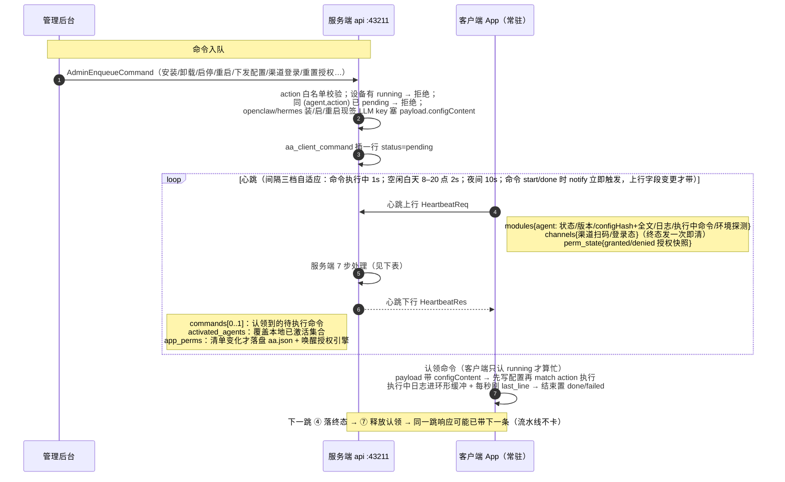
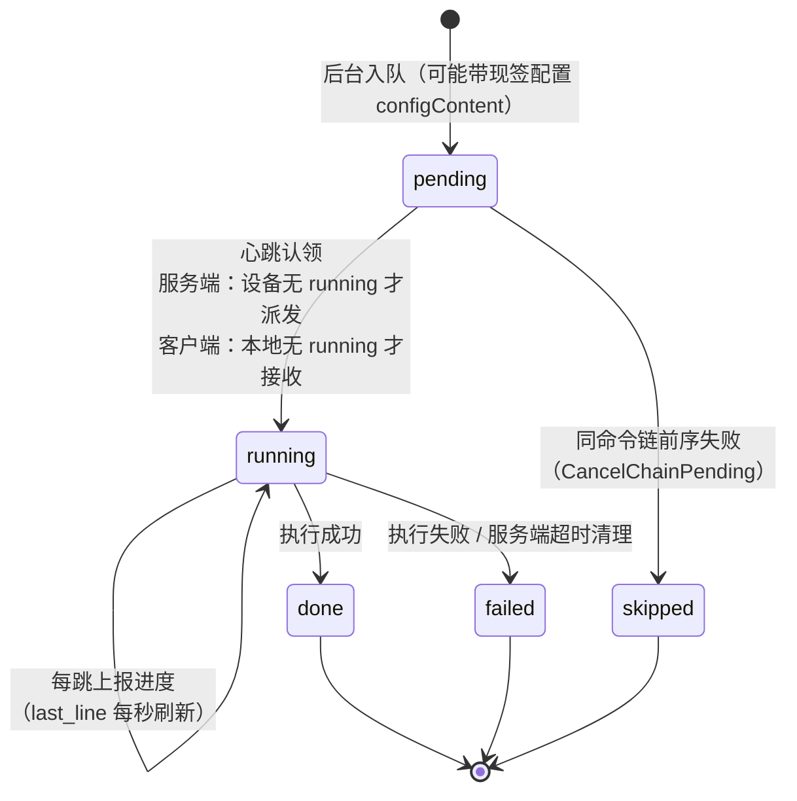

# 客户端心跳与命令通道

> 一条双向 HTTP 心跳通道捎带一切：状态/日志/配置快照/授权状态上行，命令/选中 agent/App 权限清单下行。
> 命令没有独立的推送通道——入队、认领、进度、终态全部依赖 ~10s 一跳的心跳往返。
> 本文按源码整理：服务端 `api/application/service/client_service.go`，客户端 `client/mac/src-tauri/src/lib.rs` + `platform.rs`。

---

## 一、总体流程

## 二、服务端心跳 7 步处理（`Heartbeat`，client_service.go:1426-1583）

| 步 | 做什么 | 要点 |
|---|---|---|
| ① | 按「设备选中 agent」过滤后状态 upsert | `client`（App 自身）恒放行；命令执行期 forceInsert，时间线保留 start/during/end 各行；执行中命令+环境探测写进 Extra |
| ② | 日志批插 | 带 commandId，日志归属到命令的分步视图 |
| ③ | 配置变更检测 | 客户端上报 hash 与「上次真实上报快照」（GetLatestReported，跳过 app_perm 审计行）不同才落库；归因：admin_命令 / app_perm_applied / llm_model / local_change |
| ④ | 执行中命令处理 | running → 写进度（每秒 last_line）；done/failed → 落终态；链中失败 → 取消同 chain 后续 pending |
| ⑤ | channels 合并 | 渠道扫码/登录态合并进 device.channels jsonb |
| ⑥ | 超时清理 | running 超过 action 限时 → 标 failed（孤儿命令兜底，释放队列） |
| ⑦ | 认领下一条 | **设备无 running 才 ClaimNext**；ClaimNext 返回即标 running，防止上一条还在执行时新命令变成「已认领未执行」孤儿 |

## 三、命令生命周期

客户端执行（`execute_command`，platform.rs:506）：

- payload 带 `configContent` → 先写 `openclaw.json` / hermes base 配置再执行原动作——单条命令完成「更新配置 + 装启停」
- `install` 注入 `packageUrl`（从本服务下载安装包，不直连官网）
- action 分发：install / uninstall / start / stop / restart / config_push / plugin_install / channel_login / shell / appperm_reset…

## 四、关键设计决策

| 决策 | 理由 |
|---|---|
| 单命令串行（每设备最多一条 running） | 服务端入队拦截 + 认领拦截双重保险；pending 排队（一键启用连发 plugin_install+restart 需依次执行），但同 (agent,action) 的 pending 也拦——防快速双击重复入队撞冷启动窗口 |
| 心跳即回执 | 命令进度/日志/结果没有独立通道，全靠心跳捎带；执行中间隔降到 1s 保证进度粒度，后台看到的命令延迟 ≈ 空闲间隔（白天 2s / 夜间 10s，无推送） |
| 间隔三档自适应（1s/2s/10s） | 命令执行中 1s（进度粒度）；空闲白天 2s（管理操作认领快）；夜间 10s（省两端开销）；sleep 可被 notify 打断——命令 start/done 立即发跳，终态上报不迟到；心跳失败不退避，按原节奏重试 |
| 认领即标 running | 客户端忙检查只认 running；done/failed 不挡下一条，报终态的同一轮心跳即可认领响应里同时返回的下一条，流水线不卡 |
| 配置比对基线 = 客户端上次真实上报 | 后台保存的审计行（source=app_perm）不是客户端文件状态，不能当基线；生效回执独立 source（app_perm_applied），既要进基线又要归因到后台保存（曾因同名 app_perm 导致基线永不前进、每跳插一条的事故） |
| 登录态吊销走心跳 | 心跳 401 → 清 token → 弹窗引导重登；循环不退出，重登后自动恢复 |
| 授权状态变更才上报 | 引擎维护 LAST_SENT 快照，与当前不同才带 perm_state；心跳 Ok 后收口，失败下轮重发 |

## 五、与业界方案的对照

| 本项目机制 | 成熟开源先例 |
|---|---|
| 设备周期 check-in，命令在 HTTP 响应里下发 | **Apple MDM 协议**：设备 StatusReport 的响应携带下一条排队命令（开源服务端 NanoMDM / MicroMDM） |
| 周期轮询取任务、下一周期回传结果 | **osquery + Fleet**：agent 轮询 `/distributed` 取查询，结果随下一次上报回传 |
| agent 周期 check-in，响应携带策略变更/动作 | **Elastic Agent + Fleet Server**：check-in 响应带 POLICY_CHANGE / UPGRADE 等 action |
| 配置 hash 比对、变化才落库/下发 | **Puppet** catalog 版本比对；**Firefox Remote Settings** 时间戳/hash 差异拉取 |
| 反例（持久连接流派） | Salt（ZeroMQ 长连）、Wazuh（持久 TCP）、MeshCentral / Teleport / Tailscale（WebSocket/双向流）：即时细粒度，代价是连接管理与断线重连 |

check-in 轮询是终端管理/MDM/EDR 的主流形态：终端量大、常在 NAT 后、HTTP 无状态最好运维；代价是命令延迟 ≈ 心跳间隔。

## 六、文件索引

| 位置 | 内容 |
|---|---|
| api/application/service/client_service.go:756 | AdminEnqueueCommand（入队校验/串行拦截/现签配置） |
| api/application/service/client_service.go:1406 | Heartbeat（7 步处理 + 响应构造） |
| api/application/service/client_service.go:1949 | attributeConfigChange（配置变更归因） |
| client/mac/src-tauri/src/lib.rs:928 | 心跳循环（上行组装/401 吊销/下行应用） |
| client/mac/src-tauri/src/lib.rs:1008 | 命令认领与执行器（忙检查/packageUrl 注入/spawn_blocking） |
| client/mac/src-tauri/src/platform.rs:506 | execute_command（configContent 先行 + action 分发） |
